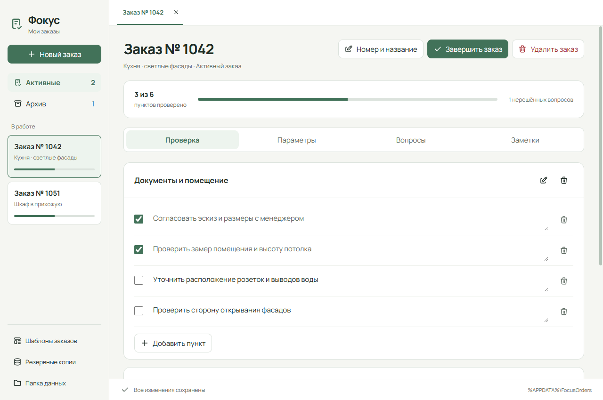

# Фокус — Заказы

Локальный рабочий блокнот для проверки мебельных заказов: несколько заказов одновременно, чек-листы, параметры, вопросы менеджерам, заметки и архив. Всё сохраняется на компьютере и работает без интернета.

[](https://github.com/Lizard51/focus-orders/actions/workflows/ci.yml)
[](https://github.com/Lizard51/focus-orders/releases/latest)
[](LICENSE)

## Скачать и установить

**[Скачать установщик 1.0.1 для Windows](https://github.com/Lizard51/focus-orders/releases/download/v1.0.1/Focus-Orders-Setup-1.0.1.exe)** · около 106 МБ

1. Скачайте `Focus-Orders-Setup-1.0.1.exe` по ссылке выше.
2. Откройте файл и пройдите шаги установщика. Можно выбрать папку установки.
3. Запустите **«Фокус — Заказы»** с рабочего стола или из меню «Пуск».
4. Нажмите **«Новый заказ»**, укажите номер/название и выберите шаблон.

Нужна **Windows 10 или 11, 64-битная**. Python, Node.js, терминал и аккаунт GitHub для обычного запуска не нужны. Встроенный движок уже включён в установщик.

[Последняя версия и файлы релиза](https://github.com/Lizard51/focus-orders/releases/latest) · [Подробная инструкция](docs/USER-GUIDE.md)

В разделе **Assets** релиза выберите файл `.exe` с названием `Focus-Orders-Setup-<версия>`. Установщик не подписан цифровым сертификатом: реакция Windows SmartScreen и антивируса на конкретном компьютере может отличаться. SHA-256 файла опубликован рядом с установщиком.

## Как выглядит



На скриншоте демонстрационные заказы. При первом запуске список заказов пустой, начальный шаблон доступен для редактирования.

## Что умеет

- Независимые заказы и вкладки для быстрого переключения.
- Редактируемые пункты проверки, произвольные параметры, вопросы и многострочные заметки.
- Копирование нумерованных нерешённых вопросов менеджеру.
- Именованные шаблоны с выбором при создании заказа; изменения шаблона не меняют старые заказы.
- Завершение, просмотр архива и возврат в работу.
- Удаление активного или архивного заказа с подтверждением и копией перед удалением.
- Автосохранение, видимые ошибки и повторная попытка без потери введённого текста в окне.
- Автоматические локальные копии, ручной экспорт и импорт старых «Данных» JSON.

## Где мои данные

Заказы находятся в `%APPDATA%\FocusOrders`, отдельно от папки программы. Кнопка **«Папка данных»** открывает этот каталог. Внизу окна виден статус сохранения.

Для переноса откройте **«Резервные копии» → «Экспортировать базу»** и сохраните JSON. Держите отдельную копию на другом диске: локальные снимки не защищают от поломки диска. Импорт или восстановление копии заменяет **всю базу**, поэтому сначала показывается предпросмотр и требуется подтверждение.

Приложение рассчитано на один компьютер. Автоматической облачной синхронизации и общей базы между устройствами нет.

## Обновление

Закройте приложение, скачайте новый установщик из [Releases](https://github.com/Lizard51/focus-orders/releases/latest) и установите поверх предыдущей версии в ту же папку. Перед обновлением полезно экспортировать базу. Заказы хранятся отдельно от установки.

## Ошибка или предложение

[Создать обращение](https://github.com/Lizard51/focus-orders/issues/new/choose). Укажите версию программы, Windows, действия и точный текст ошибки. Не прикладывайте базу заказов или данные клиентов.

## Для разработчиков

Исходники — Electron + HTML/CSS/JavaScript. Версии зависимостей зафиксированы в lockfile.

```powershell
git clone https://github.com/Lizard51/focus-orders.git
cd focus-orders
npm ci
node node_modules/electron/install.js
npm test
npm run check
npm run format:check
npm start
```

[Разработка, тесты и сборка](docs/DEVELOPMENT.md) · [Архитектура](docs/ARCHITECTURE.md) · [История версий](CHANGELOG.md)

25 тестов хранилища проверяют независимость заказов, шаблоны, архив, импорт, сохранение, копии и удаление. Исходники оформлены Prettier, формат проверяется в CI. Отдельные Electron-сценарии проверялись локально, включая запуск упакованной программы и перезапуск. Чистый компьютер получателя отдельно не проверен.

## Лицензия

[MIT](LICENSE) · [Сторонние компоненты и их лицензии](THIRD_PARTY_NOTICES.md).
